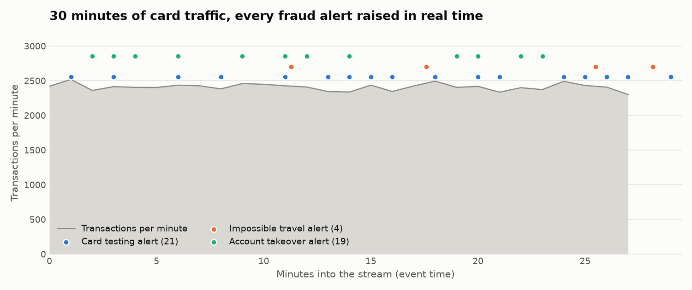
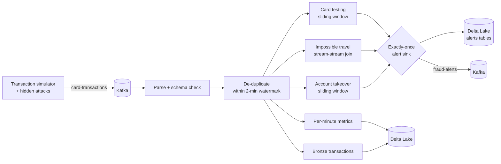
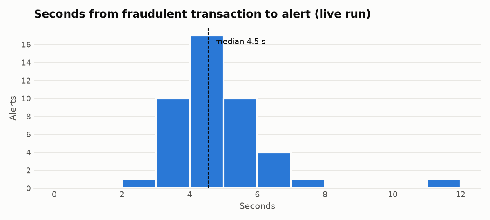

# Real-Time Card Fraud Detection

[](https://github.com/Kolli-Jahnavi-07/realtime-fraud-streaming/actions/workflows/ci.yml)

**A streaming pipeline that catches card fraud about 4 seconds after it happens.**
Card transactions flow through **Kafka** into **Spark Structured Streaming**, where three
detectors look for stolen-card behavior. Alerts are written **exactly once** to **Delta Lake**
and published back to Kafka.

| Caught | Precision | Alert latency | After `kill -9` mid-stream |
|---|---|---|---|
| **147 / 147** attacks on unseen data | **96%** | **4.6 s** median, 6.6 s p95 | **0** lost, **0** duplicated |



## What it catches

The simulator hides three real fraud patterns inside normal traffic. The pipeline never sees the answer key; it's only used afterwards for scoring.

| Attack | What the fraudster does | How the stream catches it |
|---|---|---|
| **Card testing** | Probes a stolen card with a burst of tiny charges to see if it works | Sliding 3-minute window: 5+ charges under $5 on one card |
| **Impossible travel** | Uses a cloned card in another city minutes after the real owner used it | **Stream-stream self-join**: each transaction is paired with the same card's last hour; flag speeds above 900 km/h over 500+ km |
| **Account takeover** | Drains the account with a fast spree across many merchants | Sliding 5-minute window: 6+ different merchants and $600+ spent |

To keep the scoring honest, normal traffic includes **look-alikes**: small transit and parking charges, and real shoppers on legitimate sprees at a mall. All 6 false alarms in the benchmark are those legitimate sprees (6 of 42), a trade-off a fraud team would tune against its cost of a missed attack.

## Architecture



## Engineering decisions

**Exactly-once, end to end.** Spark delivers each micro-batch *at least* once: after a crash it replays the batch that was in flight. Every sink write carries a Delta Lake *application transaction* (query name + batch id), so a replayed batch is recognized and skipped. `scripts/crash_test.py` kills the job with `SIGKILL` twice mid-stream, restarts it, and checks the result is **identical** to an uninterrupted run.

**Alerts fire immediately, not when a window closes.** Windowed rules run in *update* mode, so an alert goes out the moment the threshold is crossed. Sliding windows overlap, so the same burst shows up in several windows. A per-card cooldown in the sink collapses them into **one alert per incident**.

**Impossible travel as a join, not custom state.** The first version used PySpark's `applyInPandasWithState`, which hit a library bug in both PySpark 4.0 and 4.1. Rewriting it as a watermarked stream-stream self-join made it native Spark SQL: faster, with no Python state, and bounded memory, because Spark drops join state older than the watermark plus one hour.

**Messy input is expected.** The feed includes duplicate deliveries (network retries), out-of-order events and late arrivals. Duplicates are dropped with `dropDuplicatesWithinWatermark`, so state stays bounded. In the live run, 702 duplicate deliveries were removed and every one of the 72,289 unique transactions landed in bronze exactly once.

**Partitioned by card.** Producers key Kafka messages by `card_id`, so each card's events stay in order within a partition.

**Honest evaluation.** Thresholds were developed on one seed. The published scores come from three seeds that were never used during development, plus a separate live run.

## Results

All numbers come from the scripts in this repo and are saved as JSON in [`docs/`](docs).

**Benchmark: 3 unseen seeds, 30 minutes each** ([`benchmark.json`](docs/benchmark.json))

| Rule | Attacks | Caught | Alerts | Correct |
|---|---:|---:|---:|---:|
| Card testing | 69 | 69 | 69 | 69 |
| Impossible travel | 20 | 20 | 20 | 20 |
| Account takeover | 58 | 58 | 64 | 58 |
| **Total** | **147** | **147** | **153** | **147 (96.1%)** |

**Live run** ([`live_run.json`](docs/live_run.json)): the job runs with a 1-second trigger while 30 minutes of traffic streams in, replayed at about 5x real time (about 200 transactions per second) on a single machine in Spark local mode.
- Detection: 43 of 43 attacks caught, 97.7% precision.
- Latency, measured from when the fraudulent transaction is sent to when its alert is written: median **4.6 s**, 95th percentile **6.6 s**.



**Crash test** ([`crash_test.json`](docs/crash_test.json)): 2 hard kills mid-stream. The output is identical to an uninterrupted run: 36,056 transactions and 13 alerts, with nothing lost and nothing duplicated.

## Run it

Requires Python 3.11+ and Java 17+.

```bash
pip install -r requirements.txt
make test        # 18 unit tests: detectors, de-duplication, exactly-once sinks
make demo        # simulate 30 min of traffic, stream it, score against the answer key
make live        # live run with latency measurement
make crash       # kill -9 the job twice, prove nothing is lost or doubled
make benchmark   # score on three unseen seeds
```

With a real Kafka broker:

```bash
docker compose up -d kafka
make kafka-e2e   # produce to Kafka -> stream -> alerts to Delta and the fraud-alerts topic
```

CI runs on every push:
- the unit tests;
- a 15-minute stream that must catch at least 90% of attacks at 85%+ precision;
- the full pipeline against a **real Kafka broker**, checking that the alerts topic matches the Delta tables.

## Production considerations & limitations

This runs on one machine in Spark local mode at about 200 transactions per second. Here's what I would change to take it to production scale, and what is deliberately out of scope.

**Scaling past ~10,000 events per second**
- **Native Delta writes.** Each micro-batch is collected to the driver (`toPandas`) and written with the `deltalake` library. That keeps the project runnable on a laptop, but the driver becomes the bottleneck at volume. On a cluster, I'd switch to Spark's native writer (`df.write.format("delta")` with `txnAppId`/`txnVersion`), which keeps the same exactly-once guarantee and writes in parallel from the executors.
- **One read, many outputs.** Each of the five queries reads the source independently. At scale I'd read Kafka once into a bronze Delta table and run the detectors off that table, so Kafka is consumed once and replays come from the lake.
- **Partitions and state.** Kafka partitions and `spark.sql.shuffle.partitions` should be sized to the cluster. State already uses RocksDB, so window and join state can grow beyond memory.
- **Join fan-out.** Impossible travel pairs every transaction with the same card's last hour. That's cheap for normal cards. For merchant or test cards with thousands of transactions an hour, I'd pre-filter to one location change per card per minute.

**What production would add**
- **Schema registry** (Avro or Protobuf) instead of JSON, so producers can't break the consumer with an unannounced field change.
- **Dead-letter queue.** Records that fail parsing are currently dropped by the schema check. They should go to a DLQ topic with the reason attached.
- **Monitoring.** Track consumer lag, batch duration versus trigger interval, state size, watermark delay and alert volume per rule, with alerts when the job falls behind. The `StreamingQueryListener` events make these easy to export.
- **Deployment.** Packaged for Databricks Jobs or Spark on Kubernetes, checkpoints on cloud storage, with infrastructure as code.

**Detection scope**
- The rules are intentionally simple and explainable, which is how fraud teams often start, and a rule hit is easy to explain to a cardholder. In production they'd run beside a machine-learning model. This pipeline would compute that model's real-time features, such as transaction velocity, merchant diversity and distance from the last transaction.
- Recall is 100% because the simulator's attacks follow the patterns the rules target. Real fraud adapts, so the precision and false-alarm numbers matter more than recall, and thresholds would be tuned on labeled history and the cost of a missed fraud versus a declined good customer.

## Project layout

```
src/fraudstream/
  simulator.py   card traffic, hidden attacks, look-alikes, duplicates and late events
  detectors.py   parsing, de-duplication, the three detection rules, metrics
  sinks.py       exactly-once Delta writes, alert cooldown, Kafka publishing
  job.py         wires sources, detectors and sinks into streaming queries
  evaluate.py    precision, recall, latency and integrity against the answer key
scripts/         benchmark, live run, crash test, Kafka end-to-end, charts
tests/           unit tests
```

## Notes

All data is **synthetic**; no real cards or people are involved. Rules are deliberately simple and explainable. In production they would sit beside a machine-learning model, and this pipeline would supply that model's real-time features. Delta tables are written from each micro-batch with the `deltalake` library, which keeps the project runnable on a laptop without extra Spark packages. On a cluster, the same sinks map to Spark's native Delta writer with `txnAppId`/`txnVersion`.
